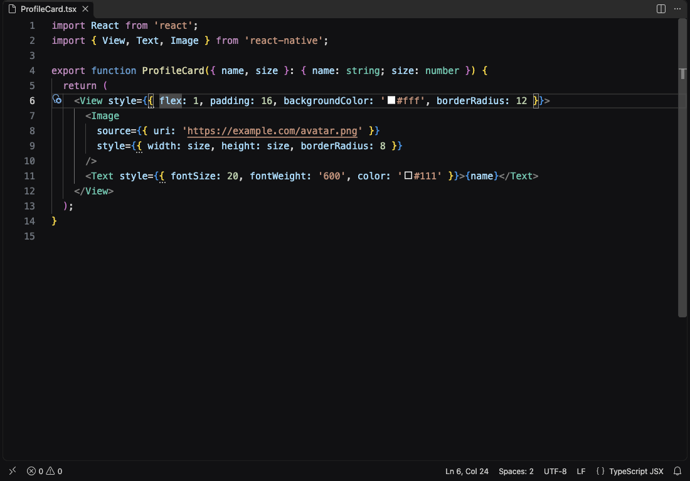
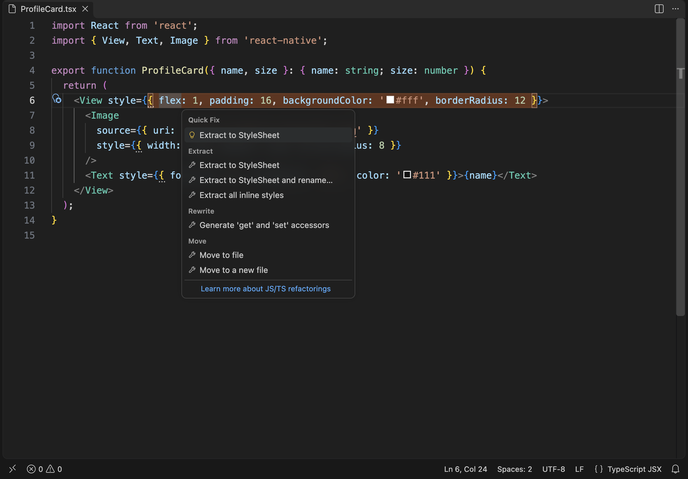
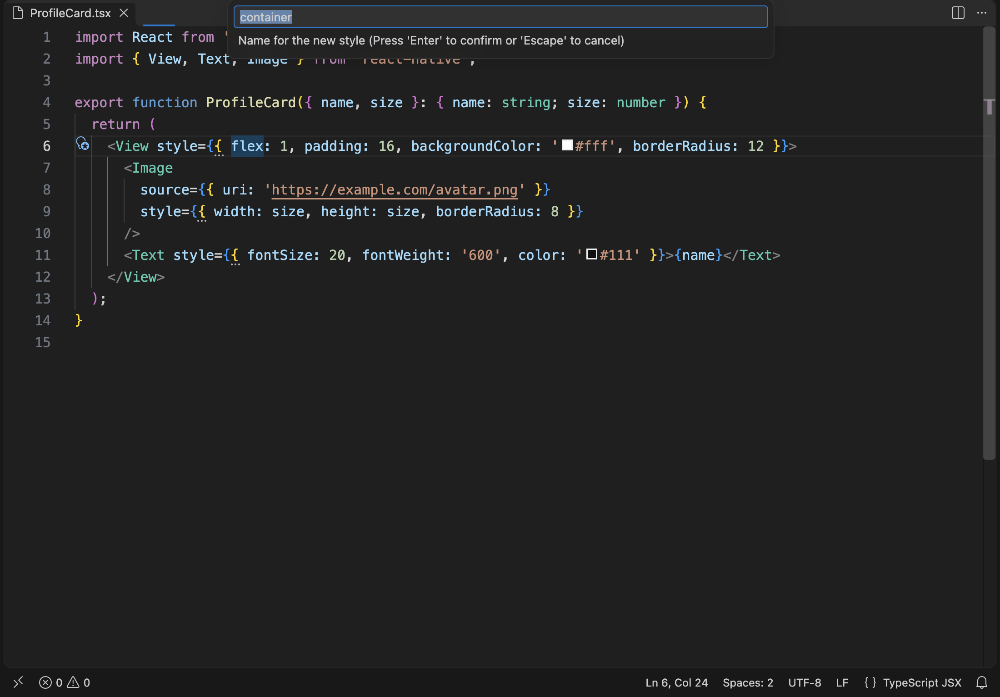
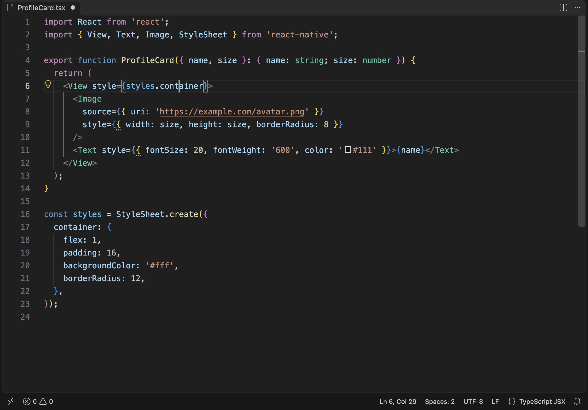
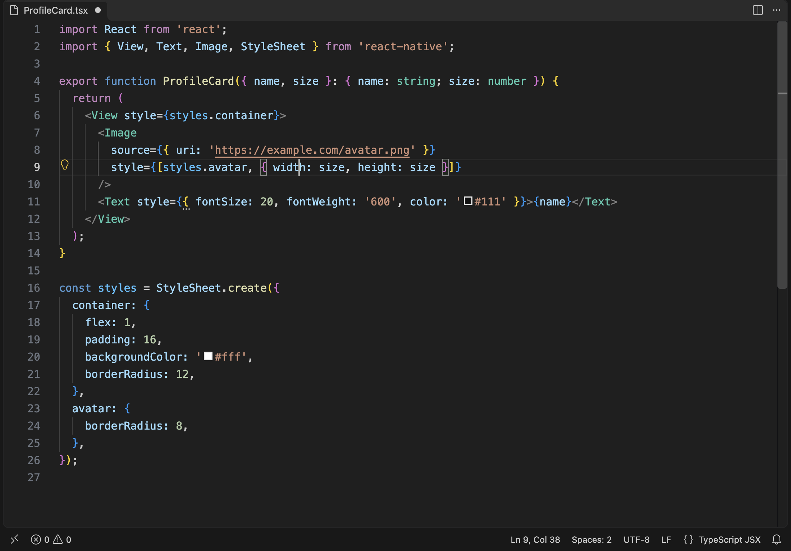

# StyleLift

Extract inline styles from React Native components into `StyleSheet.create`, with one action.

Put the cursor on `style={{ … }}`, press <kbd>Cmd</kbd>/<kbd>Ctrl</kbd>+<kbd>.</kbd>, and StyleLift moves the styles into the file's style sheet (creating it and the import if needed), names them, and leaves your formatting alone. Works in JS, JSX, TS and TSX, and it parses your code, so no regex guessing.



## Features

### Extract with one action

Inline styles get a subtle hint. Open the quick fix menu (<kbd>Cmd</kbd>/<kbd>Ctrl</kbd>+<kbd>.</kbd>) and choose **Extract to StyleSheet**.



Pick a name (the default comes from the element: `View` → `container`, `Text` → `text`, `Image` → `image`; it's checked to be a valid identifier and not already used)…



…and the style moves into `StyleSheet.create`. A missing `StyleSheet` import is added too. It all happens in a single edit, so one undo reverts everything.



### Static and dynamic values, split

Values that depend on props, state or variables stay inline; only the static part moves:

```tsx
<Image style={{ width: size, height: size, borderRadius: 8 }} />
// becomes
<Image style={[styles.avatar, { width: size, height: size }]} />
```



Inside an array style (`style={[styles.a, { margin: 4 }]}`) only the object literal is replaced. If nothing in the style is static you get a warning instead of an edit.

### More

- **Extract all**: move every inline style in the file in one action.
- **Reuse identical styles**: if the sheet already has a key with exactly the same values (key order and quotes don't matter), that key is reused instead of adding a duplicate.
- **Merge into existing style**: pick an existing key and merge the inline values into it.
- **Extract and rename**: extract with the suggested name, then jump straight into rename on the new key.
- **Inline style** (the reverse): on `styles.container`, replace the reference with its object literal. The key is removed from the sheet when that was its only use.
- **Other style props**: works on `style` and any prop ending in `Style`: `contentContainerStyle`, `columnWrapperStyle`, `imageStyle`, …
- **Separate file**: put new styles in `Component.styles.ts` and import them.
- **Several components / sheets**: new styles go to the sheet the component already uses; a sheet can have any name.
- **Formatting is preserved**: indentation (tabs or spaces), trailing commas, and multi-line imports are matched.

Not touched: lowercase tags (`<div style>`, those are DOM, not React Native).

## Settings

| Setting | Default | |
| --- | --- | --- |
| `rnStyleExtract.stylesName` | `styles` | Variable name for a new style sheet. An existing sheet, with any name, is reused. |
| `rnStyleExtract.placement` | `bottom` | Where a new sheet goes: `bottom`, `top` (after the imports) or `separateFile` (`Component.styles.ts`). |
| `rnStyleExtract.factory` | `StyleSheet.create` | Call that wraps the styles. The `StyleSheet` import is added automatically only for `StyleSheet.create`. A custom factory must take the styles object as its first argument. |
| `rnStyleExtract.sortKeys` | `false` | Sort the new style's properties alphabetically, and place the new key in sorted position when the sheet is already sorted. Existing code is never reordered. |
| `rnStyleExtract.showHints` | `true` | Show a hint on inline styles that can be extracted. |

## Commands

All are in the Command Palette under **StyleLift** and in the quick fix / refactor menu:

- Extract Inline Style to StyleSheet
- Extract Inline Style to StyleSheet and Rename
- Merge Inline Style into Existing Style
- Extract All Inline Styles in File
- Inline Style Reference

## What counts as static

Numbers, strings, booleans, `null`, negative numbers, template literals without expressions, `'absolute' as const`, and arrays or objects made of those (`transform: [{ scale: 2 }]`). Anything else (identifiers, member access, calls, conditionals, spreads) stays inline. Properties written after a spread or a computed key also stay, because moving them would let the spread override them.

## Development

```bash
pnpm install
pnpm dev          # build and open an Extension Development Host on test-fixtures/
pnpm run test:unit
pnpm test         # also runs the tests inside a real VS Code
pnpm run vsix     # package a .vsix
```

`scripts/capture-media.mjs` regenerates the icon and the images in this README by driving a real VS Code.

## License

[MIT](LICENSE)
